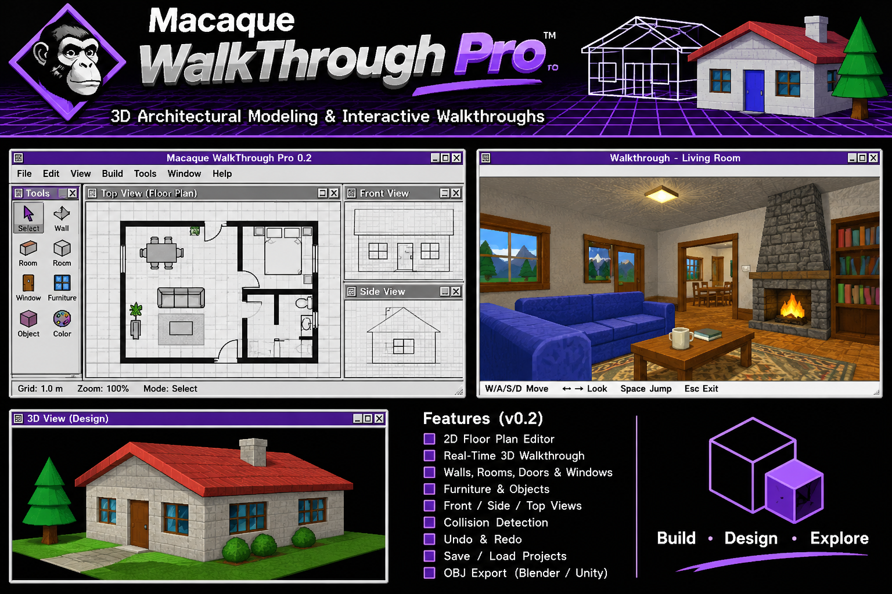

# Macaque WalkThrough Pro

A retro-inspired 3D modeling and architectural
walkthrough application inspired by Virtus
WalkThrough Pro and classic Macintosh software.

## Version 0.2 Preview

### Features

- 2D floor plan editor
- Real-time 3D walkthrough
- Walls, rooms, doors and windows
- Furniture creation tools
- Collision detection
- Front and side views
- Undo and redo
- Save and load projects
- OBJ export for Blender and Unity

## Installation

sudo apt install python3-tk

## Run

python3 walkthrough.py

## Development Roadmap

- Texture mapping
- Lighting and shadows
- Staircases and roofs
- Multiple floors
- Additional 3D primitives
- Expanded furniture library
- Classic Macintosh interface
- MacaqueOS integration

Part of the Macaque software family.

## Screenshots

### Floor Plan Editor

### Real-Time 3D Walkthrough

### Architectural Design

